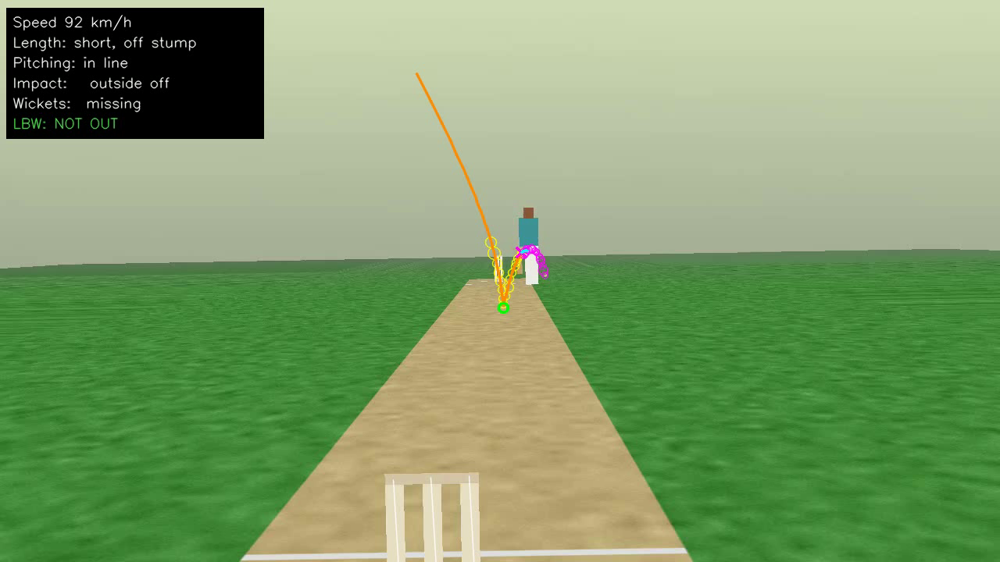

# Pocket Hawk-Eye (working name: pocketeye)

LBW ball-tracking for home, terrace and ground cricket from **one phone behind the bowler's stumps**.
For every delivery it reports:
- **LBW:** pitching (in line / outside off / outside leg), impact (in line / outside), wickets (hitting / missing / umpire's call) and the decision.
- **Ball measurements:** speed, swing, turn, line & length and bounce height at the stumps.
- **Uncertainty:** every number comes with a 90 % range.

Status: **Steps 1–4 are built**: tracking engine, Windows laptop app, camera app for old phones (Android 5+) and phone-only Android app.
The app finds the stumps by itself and can measure the pitch length from the picture.
The laptop app has an optional AI assist (YOLOX-Nano, on a dedicated GPU, integrated GPU or the CPU) that finds the
bowler and batter and double-checks ball candidates near them.
Everything is tested on synthetic videos only, not yet on real phones or real cricket.
- [docs/USER_GUIDE.md](docs/USER_GUIDE.md): **download, install and use the apps** (start here).
- [docs/PLAN.md](docs/PLAN.md): architecture and build order.
- [docs/protocol.md](docs/protocol.md): phone → laptop streaming protocol.
- [docs/accuracy.md](docs/accuracy.md): the measured accuracy, including what doesn't work well yet.

Replay output on a synthetic delivery: the fitted path (orange), detections (yellow), bounce (green), ball after the pad (magenta) and the result card.



## Repository layout

```
engine/         C++17 tracking engine (shared by the CLI, the laptop app and the phone app)
  include/      public headers, pocketeye_c.h = C API for Flutter (dart:ffi) / Android (JNI)
  src/          calibration, detector, path search, physics fit, LBW, Monte-Carlo uncertainty
  cli/          pocketeye-cli: video + session config -> JSON (+ replay video with the path drawn)
  tests/        GoogleTest unit tests for the engine math, with an independent physics simulator
app/            Flutter app: Windows laptop app (Live + File modes) and Android phone-only app
camera_lite/    Camera app for old phones (Android 5+, plain Java): streams to the laptop
tools/synth/    synthetic delivery videos with exact ground truth
tools/eval/     end-to-end accuracy evaluation (also the CI gate) and debugging helpers
tools/fake_phone.py  streams a video to the laptop app as if it were the phone
docs/           user guide, plan, protocol and measured accuracy
```

## Build (Linux / WSL / macOS; Windows with vcpkg works the same way)

Ubuntu 24.04:

```
sudo apt-get install cmake ninja-build g++ libopencv-dev libeigen3-dev libgtest-dev nlohmann-json3-dev ffmpeg
cmake -S engine -B engine/build -G Ninja -DCMAKE_BUILD_TYPE=Release
cmake --build engine/build
./engine/build/pocketeye-tests
```

## Build the apps

The `apps` GitHub Actions workflow builds the Windows zip and the APKs (see [USER_GUIDE.md](docs/USER_GUIDE.md) to download them). The workflow file shows the exact steps. In short:

- Windows: build `engine` with MSVC against the official OpenCV Windows release, copy `pocketeye_c.dll` and the OpenCV DLLs into one folder, set `POCKETEYE_NATIVE_DIR` to it, then `flutter build windows` in `app/`.
- Android: unzip the OpenCV Android SDK to `third_party/OpenCV-android-sdk` (or set `OPENCV_ANDROID_SDK`), then `flutter build apk --split-per-abi` in `app/`. The engine is built by Gradle via CMake.
- Camera app: `./gradlew assembleRelease` in `camera_lite/`.
- App tests: `POCKETEYE_LIB=engine/build/libpocketeye_c.so flutter test` in `app/`.

## Try it on a synthetic delivery

```
pip install -r tools/requirements.txt
python3 tools/synth/generate.py --out out/demo --count 3 --seed 5
./engine/build/pocketeye-cli analyze --video out/demo/scene_0000/video.mp4 \
    --config out/demo/scene_0000/config.json --timestamps out/demo/scene_0000/timestamps.txt \
    --out out/demo/scene_0000/result.json --overlay out/demo/replay.mp4
python3 tools/eval/show.py out/demo/scene_0000      # result next to the ground truth
```

## Use it on your own recording

1. Put the phone on a stand **behind the bowler's stumps**, about 1–1.5 m high (higher is better for length), looking down the pitch. Lock it; it must not move.
2. Record in good light at the highest frame rate the phone offers (60 fps if possible) with the stock camera app.
3. Grab one frame and note the pixel positions (x, y) of the **bottom and top of the left and right outer stumps** at the batter's end. If they are visible, also note the bowler's end stumps. If the bowler's stumps are out of frame, measure the camera height and its distance behind the bowler's stumps instead.
4. Measure the pitch length (stumps to stumps), stump height and stump width (outer edge to outer edge), and write a `session.json`:

```json
{
  "image": {"width": 1280, "height": 720},
  "pitch": {"length_m": 16.0, "stump_height_m": 0.66, "stump_width_m": 0.21},
  "taps": {
    "batter_left_base":  [612.0, 402.5], "batter_left_top":  [612.4, 371.0],
    "batter_right_base": [626.8, 402.9], "batter_right_top": [627.1, 371.2],
    "bowler_left_top":   [560.0, 650.0], "bowler_right_top": [720.0, 652.0]
  },
  "camera_hint": {"hfov_deg": 65},
  "ball": "tennis",
  "batter": "right"
}
```

5. Run `pocketeye-cli analyze --video clip.mp4 --config session.json --out result.json --overlay replay.mp4`. `pocketeye-cli calibrate --config session.json` checks the taps first: it reports the reprojection error and gives warnings.

"Left/right" are as seen in the picture. `ball` is one of `tennis`, `plastic`, `rubber`, `leather`. Add `--no-shot` when the batter offered no shot, which allows an impact outside off stump.

The JSON reports every delivery found in the video, with the 3D path, metrics with 90 % ranges, LBW components with probabilities, quality warnings and the time taken by each processing step.
